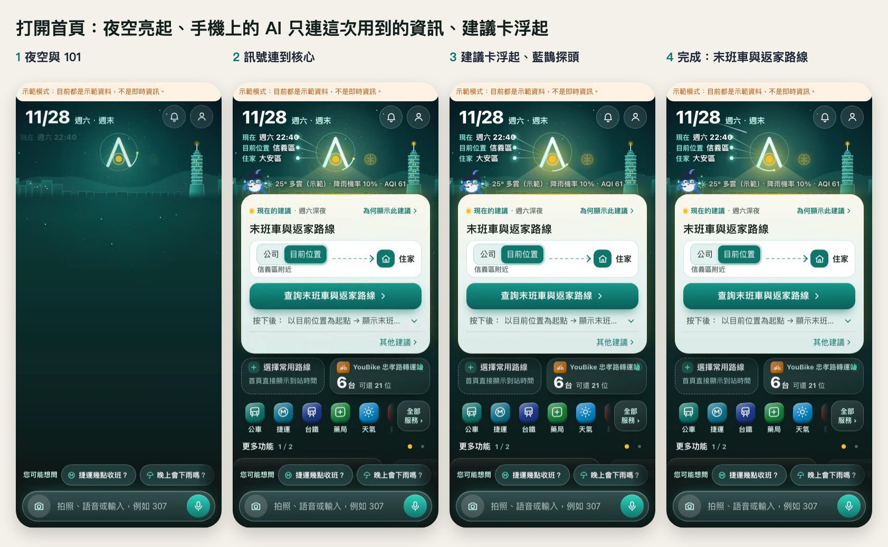
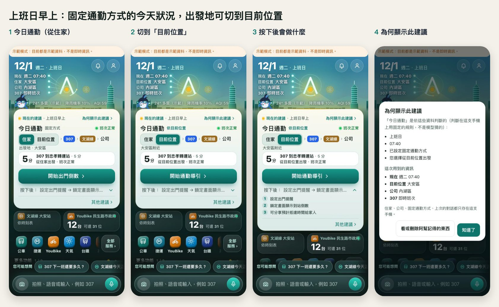
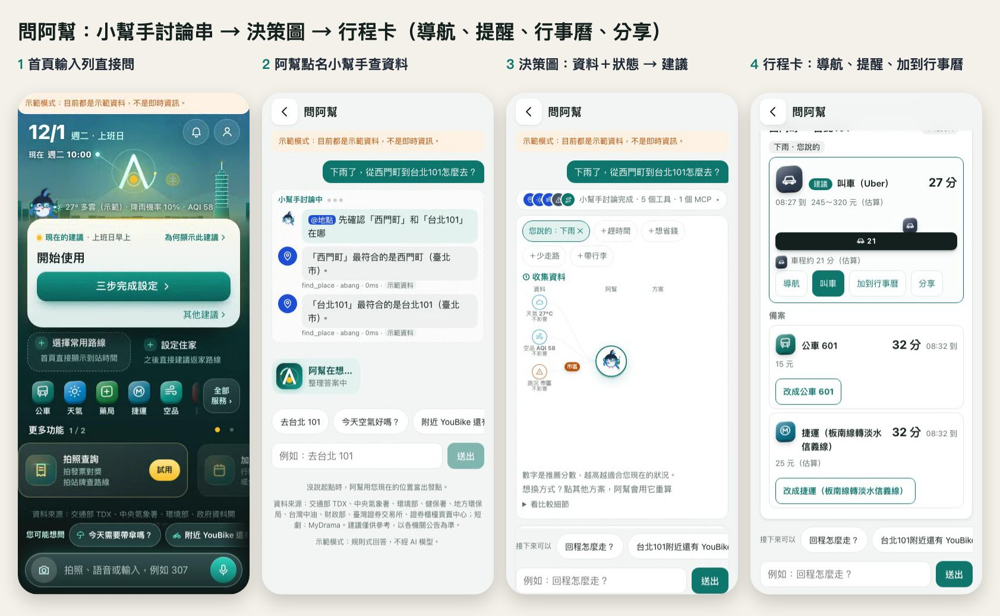
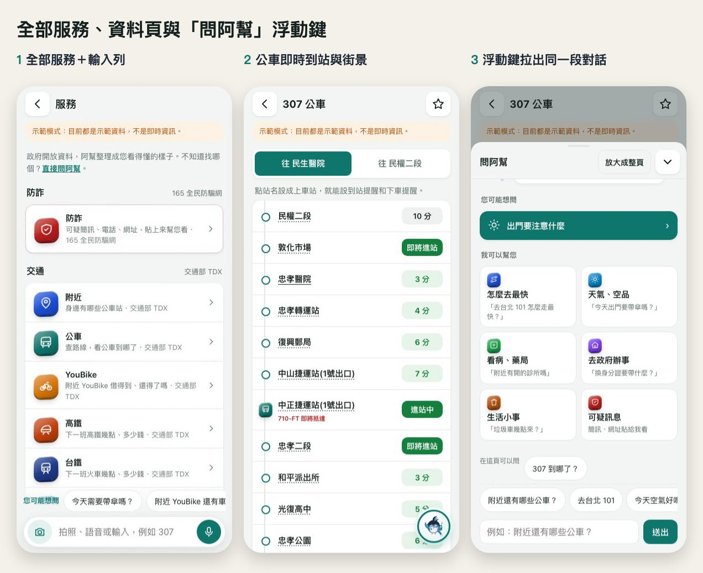

# 阿幫（A-Bang）— 打開就知道現在該做什麼的台灣生活 AI 助手

手機 App 名稱 **Abang**，吉祥物是台灣藍鵲「阿幫」。阿幫把台灣的政府開放資料（交通、天氣空品、看病藥局、垃圾車、發票、防詐、去政府辦事…）整理成一句話的建議，並在您同意後幫您動手（導航、提醒、加到行事曆、分享、叫車、訂票只給官方連結）。



## 目標

1. **打開就知道現在該做什麼**：首頁不是一格格的功能清單，而是依時間、位置、您的固定通勤方式與即時資料算出的**一張「現在的建議」**（上班日早上「今日通勤」、傍晚「今日返家」、深夜「末班車」、天氣好又動得少時「散步建議」…），按一下就做。
2. **判斷透明、資料誠實**：建議由程式依固定規則決定（`core/home-suggest.js`、`core/decide.js`），模型不編數字；每張建議都能看「為何顯示此建議」。捷運標「依時刻表」，拿不到的資料就說查不到，不寫延誤分鐘、不把示範資料當真。
3. **手機上的 AI、隱私優先**：能在手機上判斷就在手機上（Apple Intelligence、Gemini Nano）；住家、公司、固定通勤方式、健康資料、上次的對話都只存在手機，不背景追蹤位置。
4. **不只會聊天，也會動手**：拍照查詐騙與對發票、語音問、Siri 與捷徑、鎖定畫面出門倒數、主畫面小工具、加到行事曆與分享——最後一步都由您在系統畫面確認。
5. **一個核心、多個出口**：同一組 MCP tools 給 Claude 等 AI agent（遠端連接器）、民眾網頁與手機 App 使用；網頁優先、沒有任何金鑰也能用示範資料完整操作。

> 首頁設計與決策：[ADR-0023](docs/adr/0023-home-night-and-light.md)、[`docs/HOME_REDESIGN.md`](docs/HOME_REDESIGN.md)　文件網站：[`docs/index.html`](docs/index.html)　開發指引：[`CLAUDE.md`](CLAUDE.md)　計畫：[`docs/PLAN.md`](docs/PLAN.md)

## 畫面

以下都是從**實際操作的錄影**取格（示範模式、固定時鐘；`node scripts/readme-media.js` 重新產生）。

**上班日早上：固定通勤方式的今天狀況，出發地可切到目前位置，每張建議都能看理由**



**問阿幫：小幫手討論串 → 決策圖 → 行程卡**



**全部服務、即時資料頁，以及任何一頁都能拉出的「問阿幫」**



## 做得到的事

| 領域 | 內容 |
|---|---|
| 交通 | 公車即時到站與街景、捷運（含轉乘）、YouBike、台鐵、高鐵、國道客運與路況、從 A 到 B 比較各種方式（依下雨、趕時間、帶長輩…排序並說理由）、到站與下車提醒、出門倒數 |
| 生活 | 天氣與明天、空品、地震、出門建議、健保藥局、現在有看診的診所、垃圾車、油價、發票對獎（拍照或掃描）、股市收盤、散步建議（健康資料只在手機） |
| 防詐 | 可疑簡訊、網址、電話（165 開放資料＋規則庫），拍簡訊截圖也能查 |
| 去政府辦事 | 要帶什麼、最近的戶政事務所與今天是不是上班日、護照現場等待人數、官方入口（只開政府網域） |
| 手機 App | 手機上的 AI（意圖判斷、寫回答、出題）、語音、拍照讀字、Siri 與捷徑、iOS 鎖定畫面與動態島、Android 通知列與主畫面小工具、加到行事曆與分享 |

## 架構

```
 民眾網頁（PWA）──┐                ┌─ core/tools/   Tool registry（pack・tier・speak）
 Claude／AI agent ─┼─▶ server/http.js ─┤  core/decide.js 決策引擎（資料＋使用者狀態 → 排序與理由）
 iOS／Android／LINE┘   /api/v1  /mcp    ├─ core/agent/   網頁 agent（Claude、地端模型或示範模式，NDJSON 事件）
                    mcp/server.js(stdio)└─ core/services/ ＋ mock ─▶ tdx-client ─▶ 交通部 TDX、氣象署…
```

一個核心、多個出口：tool 只定義一次，MCP、REST、網頁 agent 共用；金鑰只在伺服器。詳見 [`docs/ARCHITECTURE.md`](docs/ARCHITECTURE.md)。

## 快速開始

需要 Node.js 20 以上。

```bash
npm install
cp .env.example .env      # 填入金鑰；全部留空就是示範模式
npm start                 # http://localhost:8787（PWA、/api/v1、/mcp、/api/docs）
npm run lint              # ESLint
npm test                  # 單元＋整合測試（node:test）
npx playwright install chromium   # 第一次跑 E2E 前下載瀏覽器
npm run e2e               # Playwright E2E 冒煙測試（截圖在 test/screenshots/）
npm run build:cards       # dist/cards.html：MCP Apps 互動卡片單檔（正式環境部署前要跑；開發時伺服器會自動打包）
npm run app:sync          # 手機 App：打包 dist/app 並同步到 android/、ios/（見下方「手機 App」）
```

| 金鑰 | 取得 | 沒有時 |
|---|---|---|
| `TDX_CLIENT_ID`／`TDX_CLIENT_SECRET` | [TDX](https://tdx.transportdata.tw/register) 會員中心 → API 金鑰 | 交通資料用示範資料 |
| `CWA_API_KEY` | [中央氣象署開放資料平臺](https://opendata.cwa.gov.tw) | 天氣用示範資料（M3） |
| `MOENV_API_KEY` | [環境部環境資料開放平臺](https://data.moenv.gov.tw)（免費註冊） | 空氣品質用示範資料（M10） |
| （不需要） | 藥局、垃圾車、油價、發票、股市收盤（政府開放資料） | `OPEN_DATA=0` 或 `DEMO_MODE=1` 時用示範片段（M10） |
| （不需要） | 165 防詐開放資料（data.gov.tw，免金鑰） | `OPEN_DATA=0` 或 `DEMO_MODE=1` 時用示範片段（M7） |
| `MYDRAMA_API_BASE`、`MYDRAMA_LINK_*`、`MYDRAMA_STORE_*` | 合作方提供（MyDrama 短劇，ADR-0019；只放 `.env`） | 短劇用虛構的示範片庫；沒有連結時卡片不給「在 MyDrama 看」 |
| `ANTHROPIC_API_KEY` | Anthropic Console（付費） | 網頁 agent 改用地端模型（`LOCAL_LLM_URL`＋`LOCAL_LLM_MODEL`，例如 Ollama）或示範模式（ADR-0012） |

台鐵／高鐵導訂票需另在 TDX 會員中心申請「臺鐵訂票導訂」「高鐵訂票導訂」權限。

## 用 Claude 連阿幫（MCP）

### Claude 自訂連接器（遠端）

端點：`/mcp`（全部工具）或 `/mcp/transit`（只含交通工具包）。本機測試：

```bash
npm start
npx cloudflared tunnel --url http://localhost:8787   # 取得臨時 https 網址
```

Claude「設定 → Connectors → Add custom connector」填 `https://<臨時網址>/mcp`。支援 MCP Apps 的 client 會在對話裡顯示互動卡片（公車路線、時刻表、行程…，資源 `ui://abang/cards.html`）；不支援時照樣有文字結果。

### Claude Desktop／Claude Code（stdio）

```json
{ "mcpServers": { "abang": { "command": "node", "args": ["/絕對路徑/A-Bang/mcp/server.js"],
  "env": { "TDX_CLIENT_ID": "…", "TDX_CLIENT_SECRET": "…" } } } }
```

```bash
claude mcp add abang -e TDX_CLIENT_ID=… -e TDX_CLIENT_SECRET=… -- node /絕對路徑/A-Bang/mcp/server.js
```

### Tools

| Tool | 說明 | 狀態 |
|---|---|---|
| `bus_search_routes` | 搜尋公車路線 | ✅ |
| `bus_route_eta` | 路線各站即時到站 | ✅ |
| `bus_nearby_stations` | 附近公車站與路線 | ✅ |
| `bus_station_eta` | 某站所有路線到站 | ✅ |
| `youbike_nearby` | 附近 YouBike 可借可還 | ✅ |
| `thsr_timetable`／`tra_timetable` | 高鐵／台鐵 OD 時刻表 | ✅ |
| `rail_stations` | 高鐵／台鐵車站 | ✅ |
| `metro_stations`／`metro_live_board` | 捷運車站與即時看板（北捷、桃捷機場線、中捷、高捷） | ✅ |
| `metro_route` | 捷運怎麼坐（跨系統轉乘、票價） | ✅ |
| `find_place` | 地名、車站、俗稱 → 座標（內建地標） | ✅ |
| `rail_fare` | 高鐵／台鐵票價 | ✅ |
| `traffic_status` | 沿途國道路況（順暢／車多／塞車、延誤分鐘） | ✅ |
| `intercity_bus` | 國道客運班次（含塞車延誤的預估抵達） | ✅ |
| `weather_now` | 現在天氣與 3 小時降雨機率（中央氣象署；沒有授權碼時用示範資料） | ✅ |
| `weather_tomorrow` | 明天的天氣預報（降雨機率、溫度） | ✅ |
| `outing_advice` | 出門建議：天氣＋空品一張卡（帶傘、防曬、保暖、口罩） | ✅ |
| `plan_trip` | 從 A 到 B：比較步行、YouBike、公車、捷運、高鐵、台鐵、客運、叫車，依天氣、路況與您的狀態排序並說明理由 | ✅ |
| `ridehail_link` | 叫車 App（Uber）官方連結＋距離估算車資（L2，需使用者確認） | ✅ |
| `rail_booking_link` | 台鐵／高鐵官方訂票連結（L2，需使用者確認） | 🧩 介面與示範完成；真實版需 TDX 導訂票權限 |
| `aqi_nearby`／`earthquake_recent`／`pharmacy_search`／`garbage_truck_nearby`／`fuel_price` | 生活：空品、地震、健保藥局、垃圾車、油價 | ✅（空品、地震真實資料需金鑰） |
| `invoice_lottery`／`invoice_check_batch` | 統一發票對獎（單張、我的發票批次） | ✅ |
| `stock_quote` | 上市櫃收盤行情（不提供投資建議） | ✅ |
| `scam_check_message`／`scam_lookup_url`／`scam_myth_search`／`sms_sender_check` | 阿幫・防詐：可疑訊息、涉詐網址、闢謠、簡訊寄件號碼 | ✅ |
| `clinic_search` | 現在有看診的診所（健保署，依地區、時段、科別） | ✅ |
| `gov_service_info`／`gov_office_nearby`／`passport_waiting` | 去政府辦事要帶什麼、最近的戶政事務所與辦公日曆、護照現場等待人數 | ✅ |
| `gov_official_link` | 政府官方入口（L2，只開政府網域 https） | ✅ |
| `drama_picks`／`drama_search`／`drama_series` | 等車看短劇（MyDrama 公開片庫；沒有設定時用虛構示範片庫） | 🧩 待合作方確認 |

共 41 個 tools，完整規格：[`docs/MCP_TOOLS.md`](docs/MCP_TOOLS.md)。所有 tools 唯讀（`readOnlyHint`）；結果附 `structuredContent: { card, mode, speak, data }`。

## HTTP API

API 文件：啟動後開 <http://localhost:8787/api/docs>（Swagger UI，可直接試呼叫）；規格 `GET /api/v1/openapi.json`（OpenAPI 3.1，由路由表與 tool registry 自動產生）。

| Endpoint | 說明 |
|---|---|
| `GET /healthz` | 健康檢查 `{ ok, version, mode, agent }`（容器、Cloud Run；不限流） |
| `GET /api/v1/status` | 模式、工具包、`agent`（由誰回答：claude／local／demo 與模型名稱、判斷層成員有沒有） |
| `GET /api/v1/agent/profile` | 網頁 agent 的名稱、建議問題、免責、小幫手角色 |
| `GET /api/v1/tools?pack=` | tools、工具包、分級、JSON Schema |
| `POST /api/v1/tools/:name` | 呼叫 tool；回傳 `{ name, card, mode, data, text, speak }` |
| `POST /api/v1/agent/:id` | 指定 agent（例：`antifraud` 阿幫・防詐）；格式同下 |
| `POST /api/v1/agent` | 網頁 agent，NDJSON 事件串流（[`docs/AGENT.md`](docs/AGENT.md)）；Claude／地端模型／示範模式；只給本站網頁（無 CORS）、每 IP 每分鐘／每日限流 |
| `POST /mcp`、`/mcp/:pack` | 遠端 MCP（Streamable HTTP、stateless） |
| `GET /api/v1/bus/*`、`/bike/nearby`、`/thsr/*`、`/tra/*` | 舊版 REST（PWA 使用） |

錯誤：`{ "error": "…" }`（400 參數、405 方法、413 過大、429 限流、502 上游）。502 只回通用訊息，細節只寫伺服器 log。

## 部署（Docker）

```bash
docker build -t abang .
docker run -p 8787:8787 --env-file .env abang
```

地端一鍵啟動（含連到主機上的 Ollama 地端模型）：

```bash
docker compose up -d --build
```

**判斷層**（AGENT.md §5.3）：伺服器啟動時在背景載入嵌入分類器（首次下載約 120 MB 到 `JUDGE_MODEL_DIR`，Docker 建置時已先下載）；載入前或 `JUDGE=off` 時用規則判斷，功能不受影響。

`docker-compose.yml` 會讀 `.env`（沒有就用示範模式），並把 `LOCAL_LLM_URL` 改指向主機（`host.docker.internal:11434`）；容器唯讀、`no-new-privileges`。Linux 主機需讓 Ollama 監聽 `0.0.0.0`。停止：`docker compose down`。

映像只含正式依賴與預先打包的 `dist/cards.html`，以 `node` 使用者執行；log 為一行一個 JSON（Cloud Logging 相容，不含對話內容、座標與金鑰）。金鑰請用部署平台的環境變數設定，不要放進映像。

## 環境變數

見 [`.env.example`](.env.example)：`PORT`、`DEMO_MODE`、`TDX_*`、`CWA_API_KEY`、`OPEN_DATA`、`MOENV_API_KEY`、`AGENT_PROVIDER`、`ANTHROPIC_*`、`LOCAL_LLM_*`、`RATE_LIMIT_*`、`AGENT_*`、`TRUST_PROXY`、`MCP_PACKS`、`DEMO_WEATHER`、`DEMO_TRAFFIC`、`DEMO_AIR`、`MYDRAMA_*`。

## 手機 App（Capacitor，ADR-0013）

網頁原樣包成 Android／iOS App。App 的畫面打包在 App 裡，資料連到伺服器（`ABANG_API_BASE`）。

```bash
npm run app:sync                       # 預設連 http://localhost:8787（開發）
npx cap open android                   # Android Studio 開專案、按執行
adb reverse tcp:8787 tcp:8787          # Android 模擬器連本機伺服器
npx cap open ios                       # Xcode 開專案、選模擬器執行
ABANG_API_BASE=https://您的網域 APP_RELEASE=1 npm run app:sync   # 正式版（必須 https）
```

伺服器對 App 的來源（`capacitor://localhost`、`https://localhost`）開放問阿幫與讀取 API 的 CORS，可用 `APP_ORIGINS` 調整。

App 名稱 **Abang**（吉祥物仍叫阿幫）。原生功能：本機通知（到站提醒、出門提醒，可多筆可取消）、原生定位、Android 返回手勢、裝置端 AI（ADR-0014：Android Gemini Nano、iOS Apple Intelligence 在手機上判斷意圖，不可用時由伺服器判斷，可在「設定與隱私」關閉）、阿幫會看（ADR-0015：拍可疑簡訊或選截圖查詐騙、拍站牌問路、拍發票對獎；照片只在手機上讀字〔Android ML Kit、iOS Vision〕，確認後才送文字）。第一次打開有使用說明（要定位與通知權限）；常用地點（家、公司、學校）與離線資料只存在手機；iOS 18 有深色與著色圖示。App 圖示是 Λ 標誌（`docs/BRAND.md` §2.1），藍鵲是 App 內的吉祥物。

開發時手機不休眠：Android 開發者選項開「保持喚醒（充電時螢幕不會進入休眠狀態）」；iOS 模擬器不需要。

裝置端 AI 實機評測（Android，App debug 版開著）：

```bash
adb forward tcp:9334 localabstract:webview_devtools_remote_$(adb shell pidof tw.abang.app)
node scripts/eval-edge.js 9334
```

### Agent 情境測試

`test/scenarios/life.json` 是 PM 盤點的使用情境（多輪對話＋期望），`npm test` 用示範模式跑全部；要測模型模式：

```bash
node --env-file=.env scripts/eval-scenarios.js
```

## 開發

README 的畫面：`node scripts/readme-media.js`（示範模式真的操作、錄影、從影片取格，存到 `docs/media/`）。

用 Claude Code 循環開發：照 [`docs/LOOP.md`](docs/LOOP.md)，每輪一個任務（[`docs/PLAN.md`](docs/PLAN.md) 的任務代號），紀錄在 [`docs/PROGRESS.md`](docs/PROGRESS.md)。

| 文件 | 內容 |
|---|---|
| [`PRD.md`](docs/PRD.md) | 目標、範圍、產品線 |
| [`ARCHITECTURE.md`](docs/ARCHITECTURE.md) | 架構、資料流、職責 |
| [`MCP_TOOLS.md`](docs/MCP_TOOLS.md) | tools 規格 |
| [`DATA_SOURCES.md`](docs/DATA_SOURCES.md) | 開放資料來源、端點、TTL |
| [`AGENT.md`](docs/AGENT.md) | 網頁 agent、事件協定 |
| [`HOME_REDESIGN.md`](docs/HOME_REDESIGN.md) | 首頁「夜色與光」：建議規則、ContextSnapshot、頁面矩陣 |
| [`UX.md`](docs/UX.md) | 首頁、導覽、討論串、決策圖、卡片、文案 |
| [`CARDS.md`](docs/CARDS.md) | 卡片資料契約 |
| [`TESTING.md`](docs/TESTING.md) | 測試規格 |
| [`BRAND.md`](docs/BRAND.md) | 品牌 |
| [`PLATFORM.md`](docs/PLATFORM.md) | 下一階段：阿幫平台 |
| [`adr/`](docs/adr/README.md) | 架構決策紀錄 |
| [`research/`](docs/research/) | 判斷層與裝置端 AI 評測 |

## 授權與資料來源

程式碼 MIT。資料來源：交通部 TDX 運輸資料流通服務、中央氣象署、政府資料開放平臺，依[政府資料開放授權條款](https://data.gov.tw/license)使用，畫面需標示來源。
